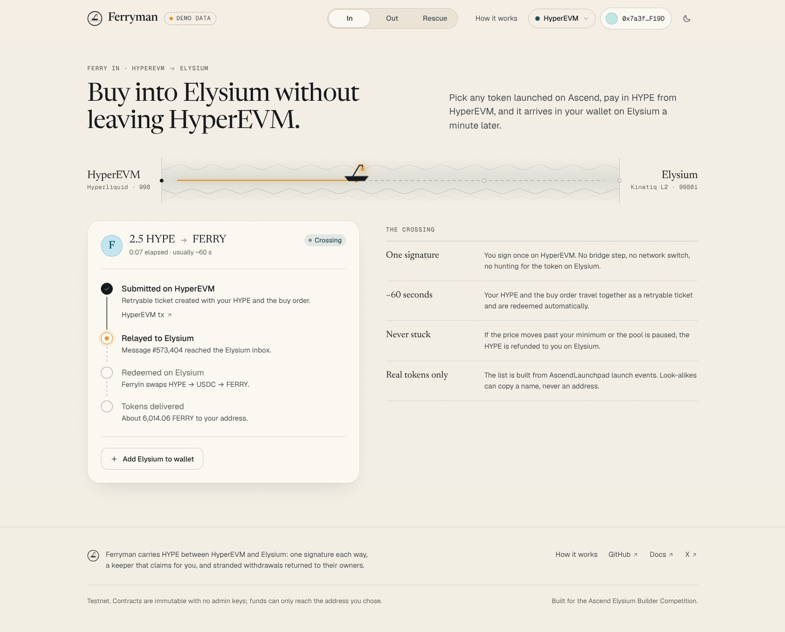
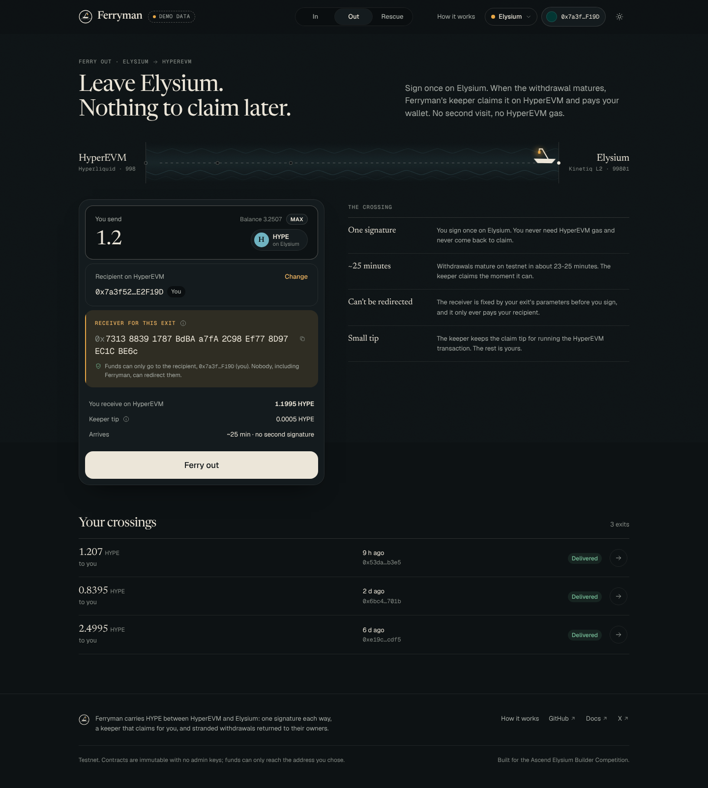
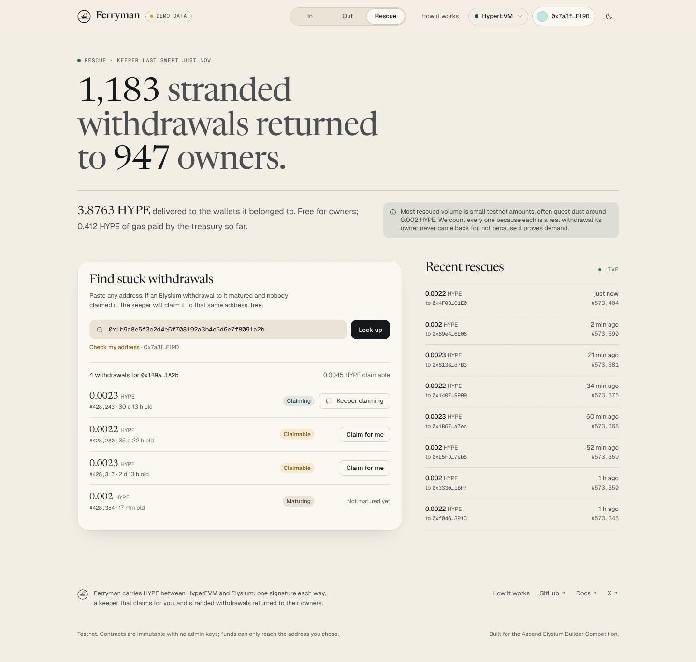

# Ferryman

**Ferryman carries you between Hyperliquid and Elysium, and back. Nothing gets stuck on the way.**

Buy into Elysium from your HyperEVM wallet in one transaction, leave Elysium in one transaction, and never claim anything by hand. Ferryman's keeper also picks up withdrawals other people left stranded and delivers them to their own wallets.

Built for the Ascend Elysium Builder Competition. Full product spec: [`details.md`](details.md).



| Ferry Out | Rescue |
|---|---|
|  |  |

## What it does

| Feature | You do | Ferryman does |
|---|---|---|
| **Ferry In** | Sign one HyperEVM transaction | A retryable ticket carries your HYPE and a buy order to Elysium. `FerryIn` buys the Ascend token and delivers it to your address, or refunds the HYPE if the price moved |
| **Ferry Out** | Sign one Elysium transaction | `ExitDesk` starts the native withdrawal to a precomputed receiver. When it matures, the keeper claims it on HyperEVM and `ExitFactory` pays you. You never touch HyperEVM |
| **Rescue** | Nothing, or paste an address | The keeper finds matured, unclaimed withdrawals and executes them. Funds always go to the original owner |
| **HyperCore landing** | One optional signature | Sends delivered HYPE to `0x2222…2222`, crediting your Hyperliquid spot balance |

## Repository

```
contracts/    Solidity (Foundry). FerryIn, InfinitySwapAdapter, ExitDesk, FeeJar, WHYPE9 on Elysium;
              ExitFactory and Receiver on HyperEVM. Immutable, no owner, no proxy. 116 tests.
keeper/       Go service: token indexer, quote API, Ferry Out claimer, Rescue, HTTP API.
web/          Svelte 5 + Vite + viem app. Runs on demo data until VITE_API_URL points at a keeper.
deployments/  Deployed addresses (testnet.json) and the HYPE route pools for FerryIn.
docs/         INTERFACES.md (shared shapes), RESEARCH.md (protocol notes), screenshots.
```

## Quick start

Requirements: Node 22 + pnpm 10, Go 1.24, Foundry.

```bash
pnpm install
pnpm dev                      # web app on demo data at http://localhost:5173

cd contracts && forge test    # contracts
cd keeper && make test        # keeper
```

Run against real chains:

```bash
# 1. HyperEVM: deploy ExitFactory
cd contracts
forge script script/DeployHyperEVM.s.sol --rpc-url https://rpc.hyperliquid-testnet.xyz/evm --broadcast --account deployer

# 2. Elysium: deploy FeeJar, ExitDesk, InfinitySwapAdapter, FerryIn
EXIT_FACTORY=0x… FEE_BENEFICIARY=0x… HYPE_ROUTES_JSON=../deployments/hype-routes.json \
forge script script/DeployElysium.s.sol --rpc-url https://testnet-rpc.elysium.kinetiq.xyz --broadcast --account deployer

# 3. Write the addresses into deployments/testnet.json, then start the keeper
cd ../keeper && cp .env.example .env   # set KEEPER_PRIVATE_KEY, CL_POOL_MANAGER
make run                               # API on :8787

# 4. Point the app at it
VITE_API_URL=http://localhost:8787 pnpm dev
```

See [`contracts/README.md`](contracts/README.md) and [`keeper/README.md`](keeper/README.md) for details.

## Safety properties

- **Ferry Out can't be redirected.** The HyperEVM receiver is a CREATE2 address derived from the full exit parameters (recipient included) and is shown before signing. `ExitFactory.claimAndSweep` only pays `params.recipient`; the claim and the sweep happen in one call, so the tip can't be stolen.
- **Ferry In never strands a ticket.** `FerryIn.buy` swaps inside `try/catch` and refunds the full HYPE to the recipient on Elysium on any failure.
- **Look-alike safe.** The token list comes only from pools whose hook is the AscendLaunchpad, never from names.
- **Rescue sends the explorer's claim calldata unchanged** to the Outbox, so funds can only reach the address that started the withdrawal.
- Every transaction the keeper sends is simulated first, and every step is idempotent across restarts.

## Status and honest notes

Everything here is built and tested offline. Some facts about the live testnet could not be checked from the build environment and must be confirmed with the kill tests in `details.md` section 11 before the demo:

- the Ascend CLPoolManager address and the hook's `hookData` expectations;
- whether Elysium's WHYPE has `deposit()` (otherwise deploy `WHYPE9`);
- whether a HYPE to quote-currency pool exists (otherwise seed a labelled one);
- the retryable gas parameters and that `createRetryableTicket` is open to EOAs;
- the live Blockscout response shapes (the keeper accepts both known variants).

Rescue volume on testnet is mostly quest dust (about 0.002 HYPE per withdrawal). The UI says so.

## Roadmap

1. Mainnet day 1: Ferry Out with auto-claim and Rescue, Ferry In for every Ascend token with "Buy from HyperEVM" links for creators.
2. Fast lane: an open filler set that pays exits within seconds, with FERRY locks granting first look.
3. Deliver anywhere: one-click HyperCore delivery once Elysium's CoreWriter ships, Ferry In from HyperCore balances.

## FERRY

FERRY launches through `AscendLaunchpad.launch()` on Elysium. Its creator fees fund Rescue gas. Keepers lock FERRY for the right to run claims and earn tips. Users never need FERRY. See `details.md` section 7.
