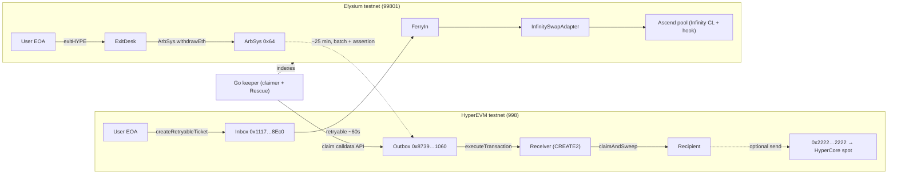

# Ferryman

**Ferryman carries you between Hyperliquid and Elysium, and back. Nothing gets stuck on the way.**

Buy into Elysium from your HyperEVM wallet in one transaction, leave Elysium in one transaction, and never claim anything by hand. Ferryman's keeper also picks up withdrawals other people left stranded and delivers them to their own wallets.

Built for the **Ascend Elysium Builder Competition** (deadline Oct 20, 2026, 23:59 UTC). The project token, **FERRY**, launches through Ascend on Elysium.

---

## 1. Overview (plain English)

Elysium is Kinetiq's fast Layer 2 for the Hyperliquid ecosystem. It settles to HyperEVM and uses HYPE for gas. New tokens launch there through Ascend.

The people who would buy those tokens mostly sit somewhere else:
- **HyperEVM** has about **8,000 daily active sending addresses**.
- **Elysium testnet** has about **434 non-developer users all-time**.

Getting between the two is a chore:
- **In:** bridge HYPE, add the Elysium network to your wallet, switch networks, then find the right token among look-alikes. That's four hops.
- **Out:** start a withdrawal, wait about 25 minutes on testnet (mainnet is undocumented), then come back and send a separate claim transaction on HyperEVM, paying HyperEVM gas.

Many people never come back to claim. Elysium's explorer shows confirmed withdrawals that nobody has claimed.

Ferryman removes that chore in both directions, with one keeper engine underneath:

| Feature | What the user does | What Ferryman does |
|---|---|---|
| **Ferry In** | Signs one transaction on HyperEVM | Carries the HYPE and a buy instruction to Elysium, buys the token, and delivers it to the same address. Refunds if the buy fails |
| **Ferry Out** | Signs one transaction on Elysium | Starts the native withdrawal, then claims it on HyperEVM when it matures and delivers the funds. The user never touches HyperEVM |
| **Rescue** | Nothing (or pastes an address) | Finds matured, unclaimed withdrawals belonging to anyone and claims them into their owners' wallets |

Optional last step: one click sends HYPE that has arrived on HyperEVM into the user's **Hyperliquid (HyperCore) trading balance**, through Hyperliquid's own system address.

---

## 2. Hackathon requirements (Ascend Elysium Builder Competition)

**Prize:** $17,500 in grants. 1st $10,000, 2nd $5,000, 3rd $2,500. Winning teams work directly with Ascend as they prepare their projects for launch.

**Judging (100 points):**
- Execution 25%: how much is built and works.
- Usefulness 25%: a real problem people would genuinely use the product for.
- Long-term vision 25%: a clear roadmap and a serious plan after launch.
- Originality 25%: what is different from what already exists.

**Rules:**
- One official submission per project.
- **Projects must launch through Ascend on Elysium.**
- **Grants are paid only after the winning project launches through Ascend.**
- Entries must be the team's own work.
- Any stage is allowed, but working prototypes, MVPs, testnet products and technical demos score better than ideas.
- No token holding, staking or trading is required to enter.
- Fraudulent, plagiarized or misleading submissions may be disqualified.
- Winning does not guarantee Ascended status, buybacks, investment, partnership or a HyperCore listing.

**Submission:** via a ticket in `#submissions` on the Ascend Discord. Include:
- project name and links (X account, website, GitHub or docs);
- a concise overview: what it is, who it's for, the problem, and why people would use it;
- a **60-120 second demo**;
- status: Working / In development / Before launch;
- a launch plan: timeline, milestones, token plans and the support needed from Ascend;
- what comes after launch;
- the team: members, experience, size and contact.

The strongest projects may be invited to a private demo and Q&A.

---

## 3. Target users

**Primary: HYPE holders on HyperEVM who want exposure to Elysium launches without moving house.**
- This is Ascend's own stated audience: "Hold your HYPE. Ascend anyway." Ascend turns HYPE deposits into kHYPE and uses the staking yield to buy into launches.
- kHYPE alone is worth about $0.9-1.2B, and about 8,000 HyperEVM addresses are active daily.
- These users won't make four hops for a new token. Ferryman makes it one.

**Secondary: Hyperliquid traders whose money sits on HyperCore and who chase new launches.**
- Their path is HyperCore to HyperEVM to Elysium and back. Ferryman shortens both legs, and the optional HyperCore landing closes the loop.

**Distribution partners, not users:** Ascend creators. Each token can get a "Buy from HyperEVM" link. Every Ferry In buyer is a new holder of an Ascend token, and holder count feeds Ascend's "Ascended" status.

**Honest caveat:** kHYPE holders are mostly passive. Whether they'll trade new launches is unproven. Ascend is making the same bet.

---

## 4. Problem evidence

- **Wrong-bucket pain** is the best-documented Hyperliquid user problem: funds on the wrong side, and no HYPE for gas where it's needed. Hyperliquid keeps standing FAQ entries for it ([Hyperliquid FAQ](https://hyperliquid.gitbook.io/hyperliquid-docs/support/faq/hyperevm-issues/gas-problem-on-evm)). Elysium adds a third bucket.
- **Exit friction:**
  - Withdrawals become claimable about 23-25 minutes after they start on testnet, measured from explorer statuses.
  - A separate HyperEVM transaction is required to claim.
  - Of 80 sampled withdrawals that matured at least 24 hours earlier, only 1 had been claimed.
  - **Caveat:** most of those are quest-farming dust (about 0.002 HYPE), so this shows indifference as much as pain. Present Rescue as work done, not as demand.
- **Demand sits on the wrong chain:** HyperEVM has about 8,000 daily active addresses, against about 434 lifetime Elysium users ([Elysium Intel](https://elysium-testnet.vercel.app)).
- **Look-alike tokens exist,** so token lists must come from AscendLaunchpad events, not from names.

---

## 5. User flows

### 5.1 Ferry In (buy an Elysium token from HyperEVM)
1. The user opens Ferryman connected to **HyperEVM** and picks an Ascend token. The list is built from AscendLaunchpad `launch` events, never from names. The user enters an amount in HYPE.
2. The UI shows a quote, simulated on Elysium via `eth_call`, with `minOut` (default slippage 1.5%, warning above 2%).
3. The user signs **one HyperEVM transaction**: `Inbox.createRetryableTicket`. It targets `FerryIn.buy(token, recipient, minOut)` on Elysium with `l2CallValue` = the HYPE amount. The refund addresses are set to the user.
4. About 60 seconds later on Elysium, the retryable auto-redeems and `FerryIn`:
   - wraps the HYPE;
   - swaps HYPE to the pool's quote token, then quote to token, through Ferryman's own price-limited Infinity adapter;
   - sends the tokens to `recipient`.
5. If anything fails (price below `minOut`, pool paused), `FerryIn` does **not** revert. It sends the HYPE to `recipient` on Elysium, so nothing is stuck in an unredeemed ticket.
6. The UI tracks the ticket through the explorer's `to-rollup` messages and offers "Add Elysium to wallet".

### 5.2 Ferry Out (leave Elysium with nothing to claim)
1. The user, connected to **Elysium**, enters an amount of HYPE and a recipient (default: their own address).
2. The UI shows the precomputed HyperEVM **receiver address** for this exit and the small claim tip.
3. The user signs **one Elysium transaction**: `ExitDesk.exitHYPE(recipient, claimTip, toCore)`. It calls `ArbSys.withdrawEth{value}(receiver)`.
4. When the withdrawal matures (about 25 minutes on testnet), the keeper fetches ready-made claim calldata from the explorer, executes it on the HyperEVM Outbox, and calls `ExitFactory.claimAndSweep(params)` in the same flow. The receiver pays the recipient, minus the tip.
5. The user never signs on HyperEVM and never needs HyperEVM gas.

### 5.3 Land on HyperCore (optional)
1. After funds land on HyperEVM, the UI offers "Send to my Hyperliquid balance".
2. The user signs one HyperEVM transfer of HYPE to `0x2222222222222222222222222222222222222222`, paying gas from the HYPE that just arrived. HyperCore credits the sender's spot balance.
3. This is trustless and non-custodial. It costs one extra signature.

### 5.4 Rescue
1. The keeper pages Elysium's `from-rollup` messages and selects those whose status is `confirmed`, have no completion hash, and are at least 24 hours old.
2. For each, it fetches the claim calldata, simulates it, and executes it on the Outbox. The funds always go to the **original recipient**. Ferryman can never redirect them.
3. The Rescue page shows a live counter ("N withdrawals returned to M owners, X HYPE"). It also has a lookup: paste any address to see its stuck withdrawals and press "claim for me".
4. Rescue is free. Gas comes from the treasury, funded by FERRY's Ascend creator fees.

---

## 6. Architecture

### 6.1 Contracts (Solidity, Foundry; immutable, no owner, no proxy)

**Elysium**
- `FerryIn`
  - `buy(address token, address recipient, uint256 minOut) payable`
  - Takes the protocol fee (0.3% of the HYPE amount, sent to `FeeJar`).
  - Wraps HYPE, then swaps through `InfinitySwapAdapter` inside `try/catch`. On any failure it refunds HYPE to `recipient`.
  - No sender authentication is needed, because the caller pays for their own buy. This makes retryable sender aliasing irrelevant.
- `InfinitySwapAdapter`
  - Swaps against Ascend's PancakeSwap Infinity CL pools through the Vault (lock/callback, then `CLPoolManager.swap`, then settle/take).
  - Enforces `minOut` and a price limit.
  - Reads `PoolKey` from launch events, including the pool's quote currency, because testnet pools use **at least two different mock USDCs**.
  - Never uses Ascend's `Swapper`, which is a test helper with no `minOut`.
- `WHYPE9` (only if needed): a WETH9-style wrapper. Elysium's WHYPE `0xCD57…F234` shows no `deposit()`, which is unconfirmed.
- `ExitDesk`
  - `exitHYPE(address recipient, uint256 claimTip, bool toCore) payable`
  - Builds `params = {chainId, nonce, amount, claimTip, recipient, toCore}`.
  - Computes `receiver = CREATE2(ExitFactory, keccak(params), RECEIVER_INIT_HASH)`.
  - Calls `ArbSys(0x64).withdrawEth{value: amount}(receiver)` and emits `ExitIntent(params, receiver)`.
- `FeeJar`: collects HYPE fees. Withdrawal rules are tied to the FERRY design in §7.

**HyperEVM**
- `ExitFactory`
  - `claimAndSweep(bytes outboxCalldata, Params params)`: executes the Outbox claim (selector `0x08635a95` = `executeTransaction`), deploys `Receiver` at the CREATE2 address if needed, then pays the recipient `amount - claimTip` and pays the tip to `msg.sender`.
  - Doing the claim and the sweep in one call closes the tip-theft hole.
  - `sweep(Params)` can be called again for stray funds.
- `Receiver`: a minimal contract with an immutable `factory`, a `receive() external payable {}` so the Outbox payout can't revert, and a `pull(to, amt)` that only the factory can call. No self-destruct.

**Roadmap only (not in v1):** `FillFactory.fill()`, which lets fillers pay users within seconds and be repaid by the receiver. It's held back because it needs outside capital, and Arbitrum fast withdrawals could make it pointless.

### 6.2 Backend (Go)
- **indexer:** reads AscendLaunchpad `launch` events and builds a verified token list with pool keys and quote currencies. Tracks `ExitIntent` events and retryable tickets.
- **quote service:** simulates Ferry In swaps on Elysium with `eth_call`. HTTP API (Go net/http, or Fastify if preferred).
- **keeper:**
  - Ferry Out claims: watches receiver-destined `from-rollup` messages, then claim endpoint, simulate, `claimAndSweep`.
  - Rescue: pages `from-rollup`, filters `confirmed` + no completion + age ≥ 24 h, then claim endpoint, simulate, `Outbox.executeTransaction`.
  - Publishes counts, value returned and gas spent.
  - Also redeems Ferry In retryables whose auto-redeem failed (`ArbRetryableTx.redeem` at `0x…6E`), so tickets don't expire.

### 6.3 Frontend (Svelte 5 + viem)
- Three tabs: **In**, **Out**, **Rescue**.
- **In:** token picker (from the indexer), quote, one-click HyperEVM buy, live ticket status.
- **Out:** the receiver address shown before signing, and a timeline: intent → confirmed → claimed → delivered, with links to both explorers. Plus the optional "Send to my Hyperliquid balance" button.
- **Rescue:** a live counter, an address lookup, and "claim for me".
- **Chains:** define Elysium testnet **99801** manually. viem's built-in `elysiumTestnet` is a different chain (1338). The HyperEVM testnet RPC needs the `/evm` suffix.

---

## 7. Token: FERRY

- **Launch:** through `AscendLaunchpad.launch()` on Elysium. Ascend mints it: fixed **1B supply**, 18 decimals, quoted in USDC (mock USDC on testnet), 1% trading fee.
- **Creator role:** handed to a fee-router contract, following Lodestar's pattern (`transferCreator`, then `acceptCreator`, then permissionless `collect`/`claim`). Creator fees fund Rescue gas and the treasury.
- **Job: the work right to run Ferryman's keeper.**
  - Keepers lock FERRY to earn claim tips and protocol fees.
  - Each claim has a short exclusive window, assigned by stake weight with a blockhash mixed in, so it can't be predicted.
  - When a filler network ships later, the same lock grants first look at fills.
- **Users never need FERRY.** They pay in the HYPE they're already moving.
- **Honest limitation:** HYPE could do the same job mechanically. FERRY exists because the competition requires a token, and its demand follows Ferryman's volume and nothing else. Nothing pays out for volume, so wash activity only costs fees.
- **Open:** whether the creator share is 50% (in the contract code) or 25% (in Ascend's docs). Ask Ascend.

---

## 8. Elysium capabilities used (live today)

| Capability | Used for | Status |
|---|---|---|
| Native HYPE deposit, HyperEVM → Elysium (`Inbox.depositEth`), about 1 min | Funding, gas drops | LIVE |
| Retryable tickets, HyperEVM → Elysium (`Inbox.createRetryableTicket`) | Ferry In | LIVE primitive. **Test first** from an EOA with calldata to our contract (allowlist very likely off: same `onlyAllowed` check as `depositEth`, which many EOAs call) |
| Native HYPE withdrawal (`ArbSys(0x64).withdrawEth`), Elysium → HyperEVM, claimable about 23-25 min | Ferry Out | LIVE. **Test first** when called from a contract |
| Outbox `executeTransaction` (anyone can execute) | Claims and Rescue | LIVE |
| Explorer `GET /api/v2/arbitrum/messages/claim/{id}` | Ready-made claim calldata, no proof generation | LIVE |
| Explorer `from-rollup` / `to-rollup` / `batches` endpoints | Tracking, Rescue discovery | LIVE |
| Ascend pools (PancakeSwap Infinity CL + hook); the hook doesn't restrict swappers | Ferry In buys | LIVE. Own adapter required |
| HyperEVM → HyperCore via `0x2222…2222` (credits `msg.sender`) | Optional HyperCore landing | LIVE on Hyperliquid testnet. **Test first** |
| HyperCore read precompile / `ElysiumCoreWriter` | Not used | Ships about 4 weeks after mainnet |
| Kinetiq HyperCore deposit wallets | Not used | Not published |

**Timings:** deposits about 1 min. Withdrawals claimable about 23-25 min on testnet. Batches post to HyperEVM about every 15 min. Retryables that aren't redeemed can expire after several days.

---

## 9. Addresses and endpoints (testnet)

| Item | Value |
|---|---|
| Elysium testnet chain ID | `99801` |
| Elysium RPC | `https://testnet-rpc.elysium.kinetiq.xyz` |
| Elysium explorer | `https://elysium.kinetiq.xyz/testnet-explorer` |
| Elysium explorer API | `https://testnet-api.elysium.kinetiq.xyz/api/v2/` |
| HyperEVM testnet chain ID | `998` |
| Inbox (HyperEVM) | `0x11178Df40CBf87a4343f4B3F8B09B366ceFA8Ec0` |
| Outbox (HyperEVM) | `0x87391D602aaffB3Fe8051EcCDb75d6EEe8C31060` |
| ArbSys (Elysium) | `0x0000000000000000000000000000000000000064` |
| ArbRetryableTx (Elysium) | `0x000000000000000000000000000000000000006E` |
| Gateway router (Elysium) | `0x89659883a9d980925733B0A698F117AAb65ac718` |
| WHYPE (Elysium) | `0xCD57F65c2B0e5881CFC2E609F7CD53b746E1F234` (no `deposit()` seen) |
| USDC (Elysium, canonical) | `0x7D29d8047B905000459c0E80c34a26CeedcB47b2` |
| USDC (HyperEVM testnet, Circle) | `0x2B3370eE501B4a559b57D449569354196457D8Ab` |
| AscendLaunchpad (also the pool hook) | `0x6d01f6644bbf1b5074472D3e85aa1465B4d2bF3d` |
| Ascend mock USDC (open `mint`) | `0x84Cc00D13173f7016Bbab22A736dBf75A154cFE2` |
| PancakeSwap Infinity Vault (Ascend) | `0x2B738A9A69b7a45C9dA6B519f6bE6efBfb912aec` |
| Ascend `Swapper` (do **not** use; test helper, no `minOut`) | `0x31A67d054D34Ec18cb23A43B0E3ad1F756aA1500` |
| Lodestar implementation (creator-fee router reference) | `0xdF26E0b534474F3b623bceE7d210c134d9677377` |
| HyperCore HYPE system address | `0x2222222222222222222222222222222222222222` |
| CoreWriter (not used in v1) | `0x3333333333333333333333333333333333333333` |

**Faucets:**
- **Elysium:** about 1 HYPE per claim at `https://elysium.kinetiq.xyz/testnet-faucet`. Browser wallet and bot check, with a cooldown.
- **HyperEVM testnet HYPE:** QuickNode faucet, no account needed, every 12 hours. Chainstack gives 1 HYPE every 24 hours but needs an account.
- **HyperEVM testnet USDC:** `faucet.circle.com`.
- **Mock USDC on Elysium:** call `mint()` on `0x84Cc…cFE2`.

---

## 10. Functional requirements and acceptance criteria

| ID | Requirement | Accepted when |
|---|---|---|
| F1 | Ferry In buys a real Ascend-launched token from one HyperEVM transaction | An explorer trail shows HyperEVM `createRetryableTicket`, then Elysium redeem, then `FerryIn.buy` swap logs, then the token balance at the same address |
| F2 | Ferry In works for tokens **we did not launch** | The same trail for a token launched by another address |
| F3 | A failed buy never strands a ticket | An impossible `minOut` leads to HYPE refunded to the recipient on Elysium |
| F4 | Ferry Out needs one signature | A user exits with only an Elysium signature, and funds arrive on HyperEVM after the keeper's `claimAndSweep` |
| F5 | Ferry Out can't be redirected | The receiver is precomputed and shown before signing, the sweep pays only `params.recipient`, and tests cover this |
| F6 | Rescue claims third-party withdrawals | At least 10 matured, unclaimed withdrawals belonging to unrelated addresses are claimed to their owners, with a counter published |
| F7 | Optional HyperCore landing | After a transfer to `0x2222…`, the HyperCore spot balance rises (Hyperliquid info API) |
| F8 | FERRY launched for real on Ascend testnet | A `launch` transaction, plus the creator role handed to the fee router and one `claim` |
| F9 | Token list excludes look-alikes | The list is built only from AscendLaunchpad events |

**Non-functional:**
- All contracts immutable and without admin keys.
- Every external call simulated before sending.
- Keeper idempotent: if a claim was already executed, skip it.
- Every number shown in the UI and submission reproducible from explorer links.

---

## 11. Day-0 kill tests (run in parallel first; each withdrawal cycle takes about 25 min)

| # | Test | If it fails |
|---|---|---|
| 1 | A contract on Elysium calls `ArbSys.withdrawEth` to a precomputed CREATE2 address. Wait for maturity, fetch claim calldata, execute it on the Outbox, deploy `Receiver`, sweep | The user's own EOA calls `withdrawEth(receiver)` and `ExitDesk` just records the intent. The guarantee is unchanged |
| 2 | Mint mock USDC, call `AscendLaunchpad.launch()` (read `LaunchParams` from the verified interface or decode a past launch), hand the creator role to the router, then run one `claim` | Use a labelled stand-in token and ask Ascend for launch access |
| 3 | An EOA calls `Inbox.createRetryableTicket` with calldata to a trivial Elysium receiver | Fallback: the user calls `depositEth`, then a keeper executes a signed (EIP-712) buy order on Elysium. Two steps, still no network switch |
| 4 | Check whether WHYPE has `deposit()`, and run one swap through our own Infinity adapter in a real Ascend pool | Deploy `WHYPE9` plus a labelled seeded HYPE/mock-USDC pool. If the adapter fails, cut Ferry In |
| 5 | Send HYPE from an EOA to `0x2222…` on HyperEVM testnet and check the HyperCore balance | Deliver to the HyperEVM wallet only and move HyperCore landing to the roadmap |
| 6 | Check Oxley's "testnet bridge" | Drop any "no other exit tool exists" claim |

---

## 12. Build plan

| When | Work |
|---|---|
| Oct 18 | Kill tests 1-6. Foundry: `ExitDesk`, `ExitFactory`, `Receiver` and tests (CREATE2 parity, sweep conditions, `receive()` under the Outbox, idempotency). FERRY launch |
| Oct 19 | `FerryIn`, `InfinitySwapAdapter` (+ `WHYPE9` and stand-in pool if needed). Go indexer, quote service and keeper (claims + Rescue running continuously). Svelte UI |
| Oct 20 (by about 20:00 UTC) | HyperCore landing button. Recruit outside testers. Record the demo and write the submission |
| Cut first if late | Ferry In (keep Out + Rescue), then the Rescue lookup page (keep the counter) |

---

## 13. Demo (90 seconds) and evidence

| Time | Shot |
|---|---|
| 0:00-0:20 | **Rescue:** the counter, then one stranger's matured withdrawal claimed by the keeper and landing in *their* wallet on the HyperEVM explorer |
| 0:20-0:50 | **Ferry In:** one HyperEVM transaction buying an Ascend token **someone else launched**, the Elysium redeem, the swap logs, the balance. Then a deliberately impossible `minOut` refunding on Elysium |
| 0:50-1:15 | **Ferry Out:** one Elysium signature, the precomputed receiver, a "+25 min real time" cut, `claimAndSweep`, funds in the wallet with no HyperEVM signature. Optional: send to HyperCore and show the balance rise |
| 1:15-1:30 | The FERRY `launch` transaction on Ascend, numbers (exits, buys, rescues, outside wallets), and the one-line pitch |

**Labels to show honestly:**
- the HYPE-to-quote conversion pool, if it is a seeded stand-in;
- Rescue volume is mostly quest dust;
- the exact count of outside wallets.

---

## 14. Risks and mitigations

| Risk | Mitigation |
|---|---|
| Kinetiq enables Arbitrum fast withdrawals | Ferryman's value doesn't depend on speed. Claims, gas and getting in still need doing. Fillers stay off the critical path |
| Retryable auto-redeem fails (gas) | Set a generous gas limit. The keeper redeems failed tickets. `FerryIn` refunds instead of reverting |
| Price moves during the ~60 s Ferry In window | `minOut` plus refund, 1.5% default slippage |
| Ascend redeploys or pauses the launchpad (it has done so twice before) | Read the launchpad address from config. The indexer handles multiple launchpad deployments |
| Two mock USDCs in testnet pools | Read the quote currency from each `PoolKey` |
| Rescue seen as "anyone can call the Outbox" | Pitch the automation and the counter, not the call. Funds always go to the original owner |
| Kinetiq adds auto-claim to its bridge UI | Ferry In and the creator buy links are the parts that remain distinct. Integrating with Kinetiq is an acceptable outcome |
| Tiny real usage on Elysium | Recruit testers in Ascend and Kinetiq Discords and Hyperliquid X. Report exact counts |

---

## 15. Open questions (ask before or during the build)

**Kinetiq:**
- What is the mainnet challenge period (`confirmPeriodBlocks`)?
- Will Arbitrum fast withdrawals (`anytrustFastConfirmer`) be enabled?
- What will the mainnet batch cadence be?
- Is third-party use of retryables and `sendTxToL1` supported?

**Ascend:**
- Are testnet launches from outside addresses OK?
- Which USDC will mainnet pools quote?
- Is the creator share 50% or 25%?
- Can `AscendCtoRegistry` or `AscendFeeController` override a creator role held by a contract?
- When is mainnet, and how do grant payouts work after launch?

---

## 16. After launch (roadmap)

1. **Mainnet day 1:**
   - Ferry Out with auto-claim and Rescue, which need no capital.
   - Ferry In for every Ascend token, with "Buy from HyperEVM" links for creators.
   - Canonical USDC as an input.
2. **Fast lane:** an open filler set that pays exits within seconds, with FERRY locks granting first look (only if mainnet exits stay slow). USDC and mirror-token exits. Sells routed through Ferry Out.
3. **Deliver anywhere:**
   - One-click HyperCore delivery once Elysium's HyperCore write path ships (about 4 weeks after mainnet).
   - Ferry In from HyperCore balances directly.
   - Auto-mirror purchased tokens back to HyperEVM.

## 17. Out of scope for v1
- Filler network and instant fills.
- USDC lanes.
- Mirror-token exits.
- One-click CoreWriter delivery.
- Selling through Ferry In.
- The delayed-inbox escape hatch.
- Any lending, oracle or order book.

## 18. Sources
- Elysium docs: [What is Elysium](https://elysium.kinetiq.xyz/docs/what-is-elysium), [Chain specifications](https://elysium.kinetiq.xyz/docs/chain-specifications), [Building on Elysium](https://elysium.kinetiq.xyz/docs/building-on-elysium), [Token bridging](https://elysium.kinetiq.xyz/docs/token-bridging-on-elysium), [Ecosystem](https://elysium.kinetiq.xyz/ecosystem)
- Elysium explorer API: [AscendLaunchpad](https://testnet-api.elysium.kinetiq.xyz/api/v2/smart-contracts/0x6d01f6644bbf1b5074472D3e85aa1465B4d2bF3d), [mock USDC](https://testnet-api.elysium.kinetiq.xyz/api/v2/smart-contracts/0x84Cc00D13173f7016Bbab22A736dBf75A154cFE2), [claim endpoint example](https://testnet-api.elysium.kinetiq.xyz/api/v2/arbitrum/messages/claim/573261), [batches](https://testnet-api.elysium.kinetiq.xyz/api/v2/arbitrum/batches)
- Arbitrum: [Fast withdrawals](https://docs.arbitrum.io/launch-orbit-chain/how-tos/fast-withdrawals), [L2-to-L1 messaging](https://docs.arbitrum.io/how-arbitrum-works/deep-dives/l2-to-l1-messaging), [AbsInbox.sol](https://raw.githubusercontent.com/OffchainLabs/nitro-contracts/main/src/bridge/AbsInbox.sol)
- Hyperliquid: [HyperCore and HyperEVM transfers](https://hyperliquid.gitbook.io/hyperliquid-docs/for-developers/hyperevm/hypercore-less-than-greater-than-hyperevm-transfers), [Gas problem FAQ](https://hyperliquid.gitbook.io/hyperliquid-docs/support/faq/hyperevm-issues/gas-problem-on-evm)
- Ascend: [X @AscendLaunch](https://x.com/ascendlaunch), [Trading fee breakdown](https://ascendlaunch.gitbook.io/docs/trading-fee-breakdown)
- Tooling: [Chainstack Elysium tooling](https://docs.chainstack.com/docs/elysium-tooling), [QuickNode Hyperliquid faucet](https://faucet.quicknode.com/hyperliquid)
